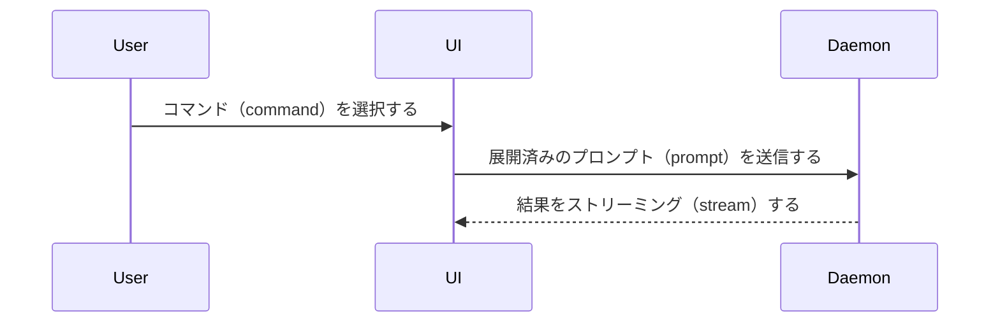

現在の会話の話題を、ユーザーが視覚的に理解できるようにする。前置きは省き、文章は簡潔にする。要点が明確に伝わる最小限の表現を選ぶ。

- ロジック（logic）やアルゴリズム（algorithm）を疑似コード（pseudocode）で示す：

```text
on(save)
  if 内容に変更がない
    return キャッシュ済みの結果（cached result）
  新しい内容を書き込む
  return 新たな結果
```

- 実行時（runtime）の制御フロー（control flow）を呼び出しツリー（call tree）で示す：

```text
submitForm
  createSession
    persistPrompt
    launchAgent
  navigateToSession
```

- UIの構造をコンポーネントツリー（component tree）で示し、重要な状態（state）とモジュールの境界（module boundaries）を含める：

```tsx
<SessionPage> (apps/example/src/routes/session.tsx)
  useSessionEvents()
  <SessionToolbar>
    <RunSkillButton> (packages/ui)
```

- ファイルの役割や広範囲のリファクタリング（refactor）を、階層の浅いファイルツリー（file tree）で示す：

```text
src/
├── commands/       # ユーザーの操作を解析する
├── sessions/       # セッション（session）の状態を所有する
└── transport/      # APIリクエスト（API requests）を送信する
```

- コンポーネント間のやり取り（component interaction）、制御フロー、またはデータフロー（data flow）をMermaidで示す：



- 変更内容が要点で、周囲の構造がすでに存在する場合は、差分（`diff`）を使う。差分の表現形式を話題に合わせる。

コンポーネントの変更の場合：

```diff
 <SessionPage>
   useSessionEvents()
   <SessionToolbar>
+    <RunSkillButton />
   <SessionTimeline>
+    <SkillResultCard />
```

ファイル配置（file layout）の変更の場合：

```diff
 src/
 ├── commands/
+│   └── show-me.ts       # スラッシュコマンド（slash command）を展開する
 ├── sessions/
-└── transport.ts
+└── transport/
+    ├── client.ts
+    └── stream.ts
```

呼び出しツリーまたは呼び出しスタック（call stack）の変更の場合：

```diff
 submitForm
   createSession
     persistPrompt
+    expandSkillMention
     launchAgent
-  navigateToSession
+  navigateToSession
+    subscribeToEvents
```

状態または制御フローの変更の場合：

```diff
 on(save)
-  内容を書き込む
+  if 内容に変更がない
+    return キャッシュ済みの結果
+  新しい内容を書き込む
+  キャッシュを無効化する
```

- 大部分が新しい場合、省略した文脈によって責任の所在（ownership）や順序が分からなくなる場合、またはユーザーがコピーできる目標の形を必要としている場合は、ブロック全体を示す：

```ts
function expandSkill(command: string): string {
  const skillName = command.slice(1)
  return `use the ${skillName} skill`
}
```

- 視覚的なUI、レイアウト（layout）、状態の比較、またはMermaidで表すには情報が込み入った概念には、要点を絞ったHTMLファイルを1つ作成する。図、インフォグラフィック（infographic）、短いスライド資料（slide deck）のうち、要点に合う形式を選ぶ。製品の配色、書体、余白、コンポーネントに合わせ、実際のラベルとデータを使い、デスクトップとモバイルに対応する。その後、ユーザーのためにファイルを開く：

```
Bash(open path/to/show-me-{description}.html)
```

### 指針

各図や視覚表現は、それが補足する短い文章の隣に配置する。ユーザーの現在の質問に答えるため、または現在の議論の論点を解決する選択肢を示すために必要な呼び出し、ファイル、プロップス（props）、状態、境界だけを残す。

これらの表現方法は1つ使っても、複数使ってもよい。すべてを使う可能性は低い。状況に応じて判断し、ユーザーが情報量に圧倒されないようにする。
